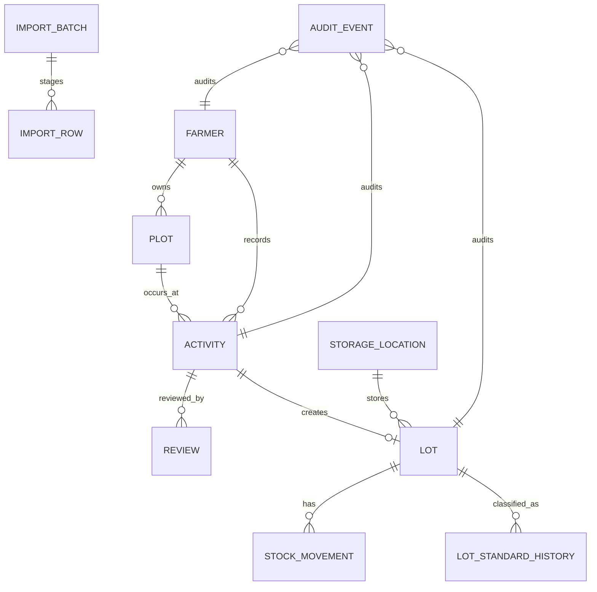

# Database Contract

> Version 1.0 · 19 October 2026  
> Source of truth for persistence design. Business services depend on `Repository`, not Google Sheets row numbers or SQL syntax.

## 1. Purpose

This document makes the MVP inspectable and portable. Google Sheets is the current pilot adapter; the logical model below is authoritative and can be implemented in PostgreSQL, SQLite, or another transactional database without changing workflow rules.

## 2. Global conventions

- IDs are stable opaque strings (`F-`, `PLOT-`, `ACT-`, `LOT-`, `LOC-`, `IMP-`, `AUD-`); row numbers are never identities.
- Timestamps are ISO 8601 UTC. Business dates such as harvest date use `YYYY-MM-DD`.
- Quantities are non-negative decimals and always paired with a controlled unit.
- Important records are voided or versioned, not hard deleted.
- Every material mutation writes an append-only `AuditEvent` with actor, action, reason, before, after, and time.
- Snapshot names on activities/lots preserve historical readability; foreign-key IDs remain authoritative.
- JSON arrays/objects are JSON strings in Sheets and native JSON/JSONB in SQL.
- Direct edits to Google Sheets bypass application audit and are unsupported during a controlled pilot.

## 3. Current implemented entities

| Entity / Sheet | Primary key | Important relationships | Purpose |
|---|---|---|---|
| `Farmers` | `farmer_id` | member code and LINE user are unique when present | Member registry |
| `Plots` | `plot_id` | `farmer_id → Farmers` | Farm plots and registered crop |
| `Activities` | `activity_id` | farmer, optional plot, optional created lot | Voice/legacy farm records and review state |
| `Reviews` | `review_id` | `activity_id → Activities` | Append-only human decisions |
| `Lots` | `lot_id` | activity, farmer, optional storage location | Traceable harvested product lot |
| `StorageLocations` | `location_id` | referenced by lots | Reusable warehouse/storage registry |
| `AuditEvents` | `audit_id` | polymorphic entity ID | Append-only before/after history |
| `Outbox` | `message_id` | optional related entity | Durable LINE delivery |

Canonical column names are defined by `TABLES` in `src/repositories/google-sheets-repository.ts`; the adapter appends missing headers without moving or deleting existing columns.

## 4. Target entities for legacy import

### ImportBatch

| Field | Type | Rule |
|---|---|---|
| `batch_id` | string PK | Stable `IMP-*` ID |
| `source_name` | string | Original filename or approved source label |
| `source_type` | enum | `CSV`, `XLSX`, `OCR`, `API` |
| `entity_type` | enum | Initial MVP: `FARMER`; extend by approved mapping |
| `checksum` | string | SHA-256 of normalized source payload |
| `status` | enum | `PREVIEW`, `READY`, `COMMITTED`, `VOID` |
| `total_rows` | integer | Non-negative |
| `valid_rows` | integer | Derived from staged rows |
| `error_rows` | integer | Derived from staged rows |
| `duplicate_rows` | integer | Derived from staged rows |
| `created_by` | string | Actor ID |
| `created_at`, `updated_at` | timestamp | UTC |

Unique constraint: `(checksum, entity_type)` for non-VOID batches. Re-uploading the same source must return the existing batch rather than duplicate it.

### ImportRow

| Field | Type | Rule |
|---|---|---|
| `import_row_id` | string PK | Stable row identity |
| `batch_id` | FK | `→ ImportBatch` |
| `source_row_number` | integer | 1-based source row |
| `raw_data` | JSON | Exact staged input after safe parsing |
| `normalized_data` | JSON | Canonical field names and normalized values |
| `row_status` | enum | `VALID`, `ERROR`, `DUPLICATE`, `SKIPPED`, `COMMITTED` |
| `issues` | JSON array | `{field, code, message}` |
| `target_entity_id` | string nullable | Filled after commit |
| `created_at`, `updated_at` | timestamp | UTC |

Import rows are staging records. Preview never writes Farmers, Plots, Activities, or Lots.

## 5. Target inventory entities

### StockMovement

Append-only movement with `movement_id`, `lot_id`, type (`RECEIVE`, `RESERVE`, `RELEASE`, `SHIP`, `ADJUST`, `RECALL`), quantity, unit, actor, reason, reference, and occurred time.

Balances are derived, not manually typed:

```text
on_hand  = RECEIVE - SHIP ± approved ADJUST
reserved = RESERVE - RELEASE - shipment against reservation
available = on_hand - reserved, only when lot eligibility is true
```

Transactions must reject negative balances and unit mismatches.

### LotStandardHistory

Append-only history containing lot, controlled status (`T1`, `T2`, `PASSED`, `ON_HOLD`, `REJECTED` after ICS approval), effective time, actor, reason, and evidence reference. The latest effective record is current; status is never silently overwritten.

## 6. Relationship map



## 7. Database portability mapping

| Logical type | Google Sheets | PostgreSQL |
|---|---|---|
| ID/text | cell string | `text` or `uuid` plus display prefix |
| timestamp | ISO string | `timestamptz` |
| date | `YYYY-MM-DD` | `date` |
| decimal quantity | numeric cell/string | `numeric(18,3)` |
| JSON | JSON string | `jsonb` |
| enum | validated string | check constraint or lookup table |
| uniqueness/FK | service validation | database unique/FK constraints |

For PostgreSQL migration: create schema migrations, backfill by stable IDs, verify counts and checksums per entity, switch the repository adapter behind a feature flag, run dual-read comparison, then cut over. Do not dual-write without an idempotent transaction/outbox design.

## 8. Backup, retention, and security

- Backup includes every entity and a canonical SHA-256 checksum.
- Restore is validate-first and merge-only; destructive restore requires a separately approved runbook.
- Credentials never live in Sheets or backup archives.
- Audio retention and personal-data retention remain policy decisions (`T-009`) and must be approved before production rollout.
- Durable multi-user/RBAC is intentionally last in the current roadmap, but is mandatory before multiple independent staff accounts edit production data.

## 9. Change procedure

Any schema change must update this file, domain types, repository contract, every adapter, backup schema, automated tests, `FEATURES.md`, `TASKS.md`, and `WORKLOG.md`. Additive Sheet headers are safe; renames/removals require an explicit migration and rollback plan.
