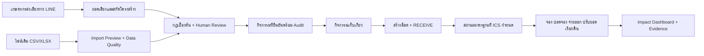

# Process Map — As-Is / To-Be

> สถานะ: เอกสารสำหรับนำเสนอและยืนยันกับเจ้าของกระบวนการ ข้อความ As-Is ต้องตรวจทานกับชุมชนก่อนใช้เป็นข้อเท็จจริงภายนอก

## As-Is ที่ต้องยืนยันภาคสนาม

จุดเก็บ baseline: เวลาต่อรายการ, จำนวนจุดกรอกซ้ำ, ช่องว่าง, ครั้งที่ส่งกลับแก้, ความคลาดเคลื่อนยอดล็อต และเวลาค้นหลักฐาน

## To-Be ที่ระบบรองรับ

## Owner / Handoff / Control

| ขั้นตอน | Owner ที่ต้องยืนยัน | Handoff | Control ในระบบ |
|---|---|---|---|
| ข้อมูลเดิม | เจ้าของข้อมูลชุมชน | ไฟล์/เอกสารให้ผู้นำเข้า | checksum, preview, error report, provenance |
| กิจกรรมใหม่ | เกษตรกร | LINE → ระบบ → ICS | source event, correction revision, human review |
| ผลตรวจ | เจ้าหน้าที่ ICS | review → activity | before/after audit, เหตุผล, เวลา |
| สร้างล็อต | คลัง/ICS | harvest activity → lot | harvest-only guard, unique lot, QR |
| สถานะมาตรฐาน | ผู้มีอำนาจ ICS | definition → lot history | controlled list, evidence, effective time |
| จัดสรรสินค้า | คลัง | lot → reservation/order | available guard, expiry, idempotency |
| รายงานผล | ผู้จัดการโครงการ | operational data → dashboard | metric definition, period, sample size; ไม่สร้างค่าจำลอง |

