# System Flow — Voice-to-ICS & Smart Inventory

> เอกสารนี้ใช้เป็นภาพประกอบการนำเสนอและเป็นข้ออ้างอิงร่วมของทีมพัฒนา
>
> เวอร์ชัน: 0.1.0 · อัปเดตล่าสุด: 17 ตุลาคม 2569

## 1. แนวคิดของระบบในหนึ่งประโยค

เกษตรกรพูดบันทึกงานผ่าน LINE ระบบแปลงเสียงเป็นข้อมูลที่ตรวจสอบได้ เจ้าหน้าที่ ICS รับรองรายการที่มีผลต่อมาตรฐาน และกิจกรรมเก็บเกี่ยวที่ผ่านการยืนยันจะเชื่อมต่อไปเป็นล็อตสินค้าพร้อม QR สำหรับตรวจสอบย้อนกลับ

## 2. ผู้ใช้งานและหน้าที่

| ผู้ใช้งาน | ช่องทาง | งานหลัก | สิ่งที่ระบบต้องรับประกัน |
|---|---|---|---|
| เกษตรกร | LINE Official Account | ส่งเสียงบันทึกกิจกรรม ยืนยันหรือแก้ข้อมูล ดูบันทึกของตน | ใช้ง่าย ไม่ต้องพิมพ์มาก ได้รับผลตอบกลับชัดเจน |
| เจ้าหน้าที่ ICS | Web Dashboard | ตรวจรายการเสี่ยง แก้ข้อมูล อนุมัติหรือขอข้อมูลเพิ่ม | เห็นหลักฐาน เหตุผล และประวัติการแก้ไขครบ |
| ผู้จัดการคลัง | Web Dashboard | ตรวจล็อต เปลี่ยนสถานะคลังและการจัดส่ง | ล็อตไม่ซ้ำ ย้อนกลับถึงกิจกรรมต้นทางได้ |
| ผู้ตรวจสอบ/ผู้รับสินค้า | หน้า Trace สาธารณะตามสิทธิ์ | สแกน QR เพื่อตรวจที่มา | เห็นเฉพาะข้อมูลที่อนุญาตและไม่เปิดเผยข้อมูลส่วนบุคคลเกินจำเป็น |
| ผู้ดูแลระบบ | Web Dashboard | จัดการผู้ใช้ กฎความเสี่ยง และสถานะบริการ | การเปลี่ยนแปลงสำคัญมี audit trail |

## 3. ภาพรวมระบบ

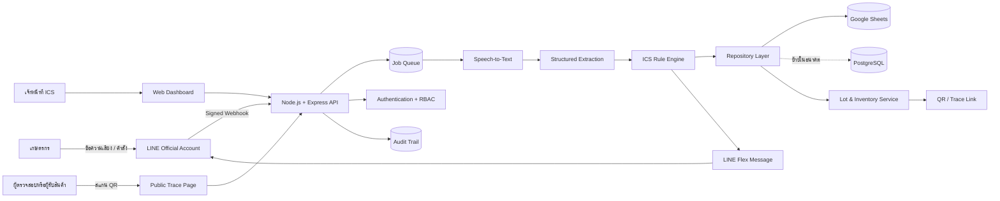

### หลักการแบ่งความรับผิดชอบ

- **LINE** เป็นช่องทางรับข้อมูลจากเกษตรกร ไม่ใช่ฐานข้อมูลหลัก
- **API** ตรวจลายเซ็น รับคำขอ และตอบกลับอย่างรวดเร็ว
- **Job Queue** แยกงานที่ใช้เวลานาน เช่น ดาวน์โหลดเสียงและเรียก AI ออกจาก webhook
- **AI Extraction** ทำหน้าที่แปลงเสียง/ข้อความเป็นข้อมูลที่มีโครงสร้าง
- **ICS Rule Engine** ใช้กฎที่ควบคุมและทดสอบได้ ไม่ให้ AI ตัดสินมาตรฐานลำพัง
- **Human Review** เป็นจุดรับรองผลเมื่อข้อมูลไม่ครบ ความมั่นใจต่ำ หรือมีความเสี่ยง
- **Repository Layer** แยก business logic ออกจาก Google Sheets เพื่อย้ายฐานข้อมูลได้
- **Audit Trail** บันทึกว่าใครเปลี่ยนอะไร จากค่าใดเป็นค่าใด และเมื่อไร

## 4. Flow A — ลงทะเบียนและผูกบัญชีเกษตรกร

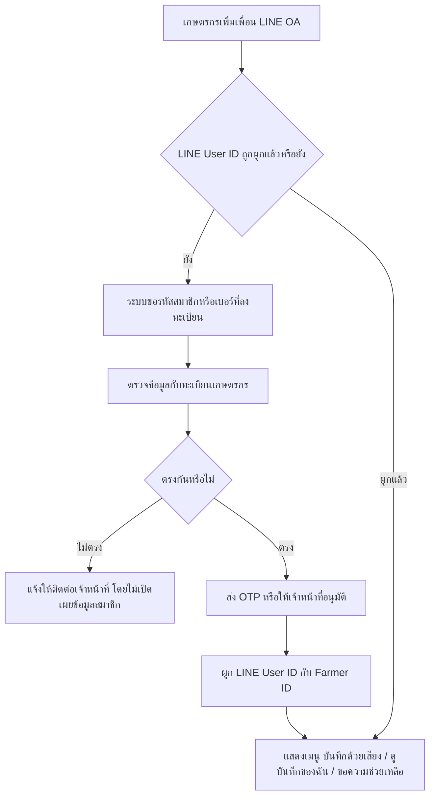

จุดควบคุมสำคัญ:

1. ไม่ใช้ LINE display name เป็นตัวระบุเกษตรกรหลัก เพราะเปลี่ยนได้และชื่อซ้ำได้
2. เก็บ `Farmer_ID` และ `LINE_User_ID` แยกกัน
3. บัญชีหนึ่งต้องไม่ผูกเกษตรกรหลายคนโดยไม่ผ่านขั้นตอนเจ้าหน้าที่

## 5. Flow B — บันทึกกิจกรรมแปลงด้วยเสียง

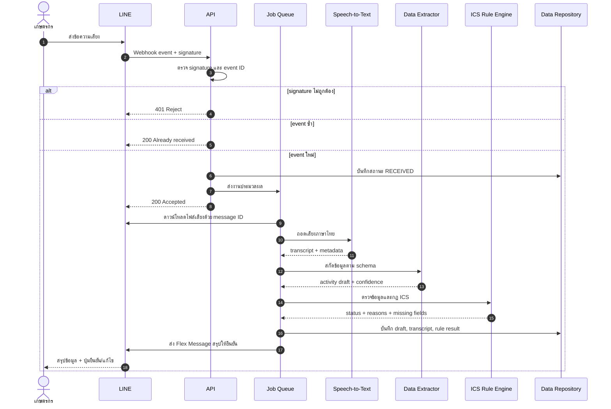

### สถานะของงานประมวลผล

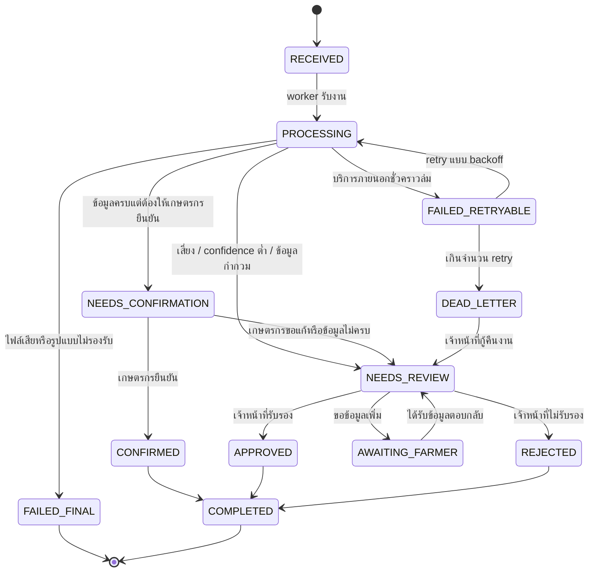

## 6. Flow C — การประเมินความเสี่ยงแบบน่าเชื่อถือ

AI ไม่ควรส่งค่า `Passed` แล้วถือเป็นผลรับรองทันที ระบบจึงแยกเป็น 3 ชั้น:

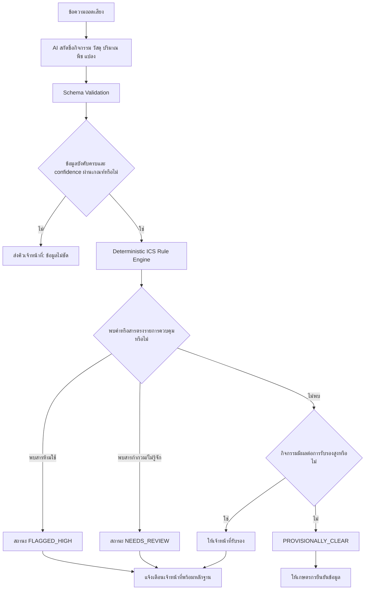

### ผลลัพธ์ที่ใช้ในระบบ

| สถานะ | ความหมาย | ผู้ตัดสินขั้นสุดท้าย |
|---|---|---|
| `PROVISIONALLY_CLEAR` | ไม่พบเงื่อนไขเสี่ยงจากกฎ แต่ยังเป็นผลเบื้องต้น | ระบบ + การยืนยันข้อมูล |
| `NEEDS_REVIEW` | ข้อมูลไม่ครบ กำกวม หรือพบวัสดุที่ยังไม่รู้จัก | เจ้าหน้าที่ ICS |
| `FLAGGED_HIGH` | ตรงกฎความเสี่ยงสูงหรือสารห้ามใช้ | เจ้าหน้าที่ ICS |
| `APPROVED` | เจ้าหน้าที่ตรวจและรับรองแล้ว | เจ้าหน้าที่ ICS |
| `REJECTED` | เจ้าหน้าที่ตรวจแล้วไม่รับรอง | เจ้าหน้าที่ ICS |

## 7. Flow D — เจ้าหน้าที่ตรวจสอบรายการ

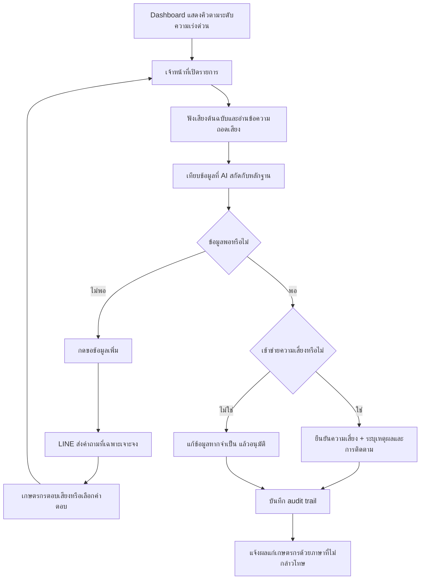

Dashboard ต้องแสดงพร้อมกัน:

- เสียงต้นฉบับหรือปุ่มเล่นเสียง
- ข้อความที่ถอดได้
- ข้อมูลที่ AI สกัด พร้อม confidence รายฟิลด์
- กฎที่ทำให้เกิดการแจ้งเตือน
- ประวัติการแก้ไขและผู้ดำเนินการ
- ปุ่ม “ขอข้อมูลเพิ่ม”, “อนุมัติ”, “ยืนยันความเสี่ยง” และ “ยกเลิก” ที่แยกกันชัดเจน

## 8. Flow E — เก็บเกี่ยวและสร้างล็อตสินค้า

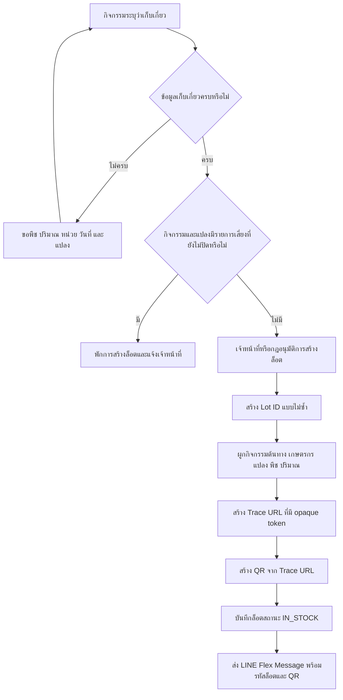

รูปแบบ Lot ID ที่แนะนำ:

```text
{CROP_CODE}-{BUDDHIST_YEAR_SHORT}{MM}{DD}-{FARMER_CODE}-{SEQUENCE}
ตัวอย่าง: SOY-691017-LD-01
```

ข้อกำหนด:

- Lot ID สร้างที่ server และมี unique constraint หรือ lock ป้องกันเลขซ้ำ
- QR ต้องบรรจุ URL สำหรับ trace ไม่ใช่เพียง Lot ID เพื่อใช้งานสะดวก
- ห้ามใส่ข้อมูลส่วนบุคคลหรือ secret ลงใน QR
- หากยกเลิกล็อต ให้เปลี่ยนสถานะเป็น `VOID` และเก็บประวัติ ห้ามลบแถวทิ้ง

## 9. Flow F — ค้นหาและตรวจสอบย้อนกลับ

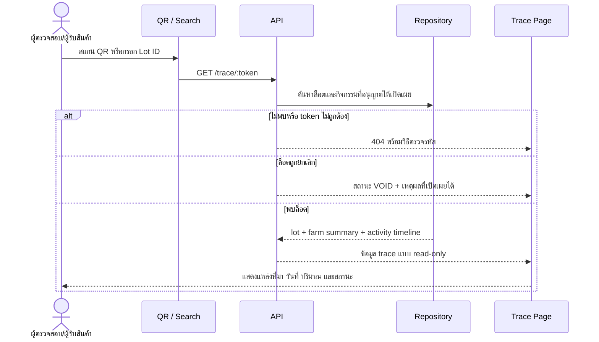

ข้อมูลสาธารณะที่แนะนำ:

- รหัสล็อต พืช ปริมาณ วันที่เก็บเกี่ยว
- กลุ่มเกษตร/พื้นที่ระดับชุมชน โดยไม่เปิดที่อยู่ละเอียด
- timeline กิจกรรมที่อนุญาตให้เผยแพร่
- สถานะล็อตและเวลาอัปเดตล่าสุด
- ข้อความชี้แจงว่าการแสดงข้อมูลไม่ใช่ใบรับรองอัตโนมัติ

## 10. Flow G — การเปลี่ยนสถานะคลัง

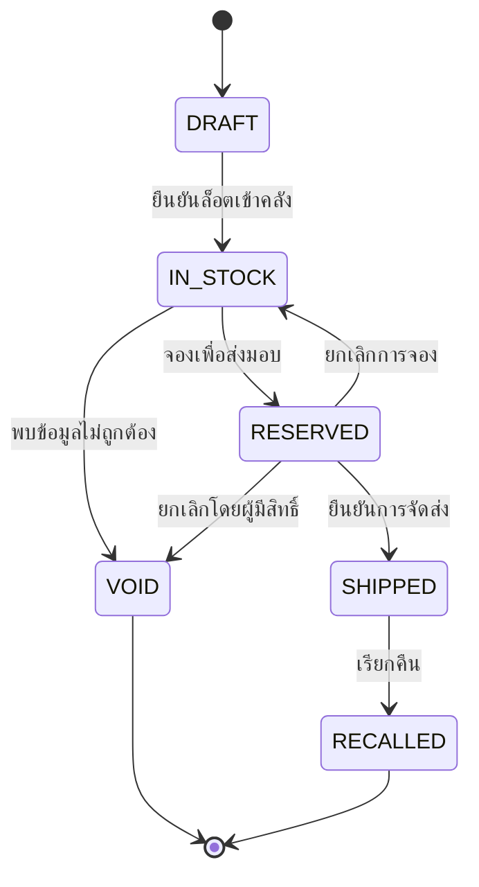

ทุก transition ต้องบันทึกผู้ดำเนินการ เวลา เหตุผล และค่าก่อน/หลัง

## 11. Flow H — เมื่อบริการภายนอกขัดข้อง

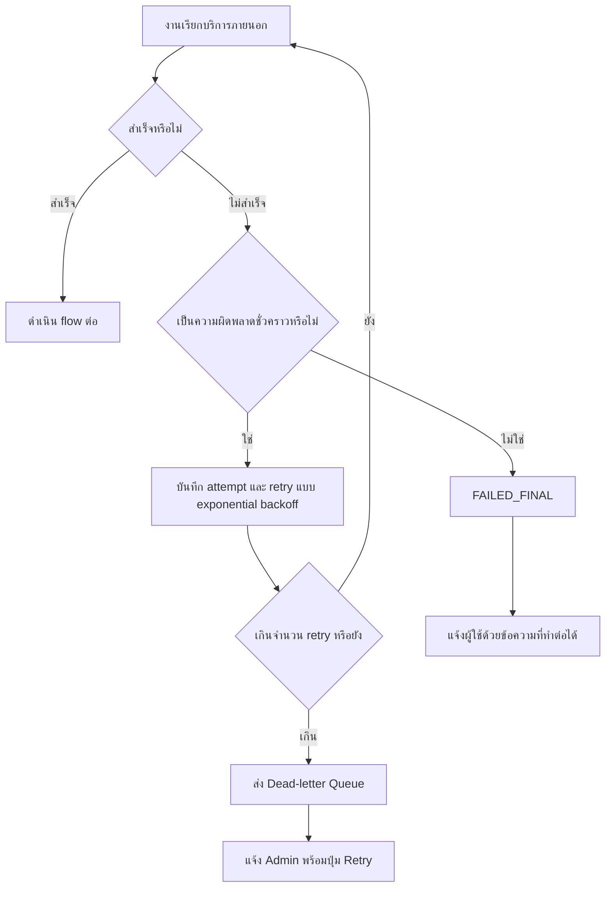

| จุดขัดข้อง | พฤติกรรมของระบบ | ข้อความผู้ใช้ |
|---|---|---|
| LINE ส่ง webhook ซ้ำ | ตอบ 200 แต่ไม่สร้างงานซ้ำ | ไม่ต้องแจ้งซ้ำ |
| ดาวน์โหลดเสียงไม่ได้ | retry แล้วเข้าคิวเจ้าหน้าที่ | “ระบบรับรายการแล้ว กำลังตรวจสอบไฟล์เสียง” |
| Speech-to-Text ล่ม | retry โดยไม่ให้เกษตรกรส่งใหม่ทันที | “รับเสียงแล้ว ระบบจะส่งผลเมื่อประมวลผลเสร็จ” |
| AI คืนข้อมูลผิด schema | validate, retry แบบ constrained และส่ง human review | “ระบบฟังได้บางส่วน เจ้าหน้าที่จะช่วยตรวจสอบ” |
| Google Sheets quota เต็ม | เก็บใน queue/outbox และ sync ภายหลัง | Dashboard แสดงสถานะ sync ล่าช้า |
| QR service ล่ม | สร้าง QR ภายในระบบหรือ retry | ล็อตยังถูกสร้าง แต่ QR อยู่สถานะกำลังเตรียม |
| Worker หยุดทำงาน | health check แจ้งเตือนและงานค้างใน queue | ไม่สูญหายและไม่ทำซ้ำ |

## 12. Flow I — Authentication และสิทธิ์

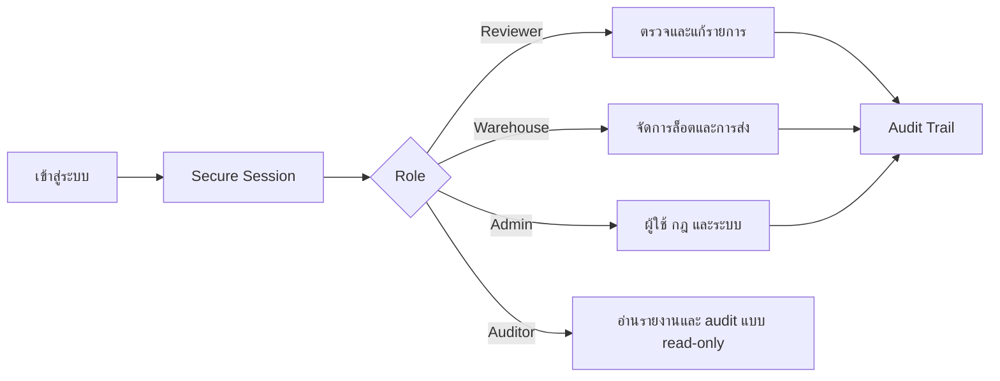

หลักการ:

- ใช้ session cookie แบบ `HttpOnly`, `Secure`, `SameSite=Lax/Strict`
- password ต้อง hash ด้วย Argon2id หรือใช้ identity provider ที่เชื่อถือได้
- ตรวจสิทธิ์ที่ server ทุกครั้ง ไม่อาศัยการซ่อนปุ่มใน UI
- งานเสี่ยง เช่น void lot, เปลี่ยนกฎ หรือ export ข้อมูล ต้องยืนยันซ้ำและบันทึกเหตุผล

## 13. โครงสร้างข้อมูลเชิงแนวคิด

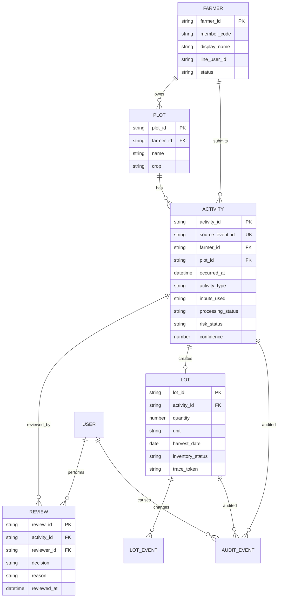

## 14. หน้าจอ Web Dashboard

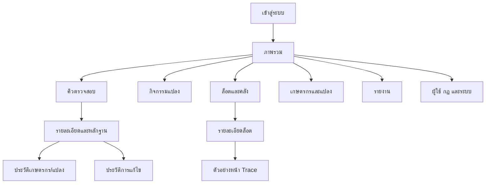

ลำดับความสำคัญหน้าแรก:

1. งานเสี่ยงที่ต้องดำเนินการทันที
2. งานที่รอข้อมูลหรือรอตรวจ
3. สุขภาพการประมวลผลและรายการ sync ล่าช้า
4. สรุปกิจกรรมและล็อต โดยตัวเลขทุกตัวกดดูรายการต้นทางได้

## 15. Deployment Flow แบบใช้งานจริง

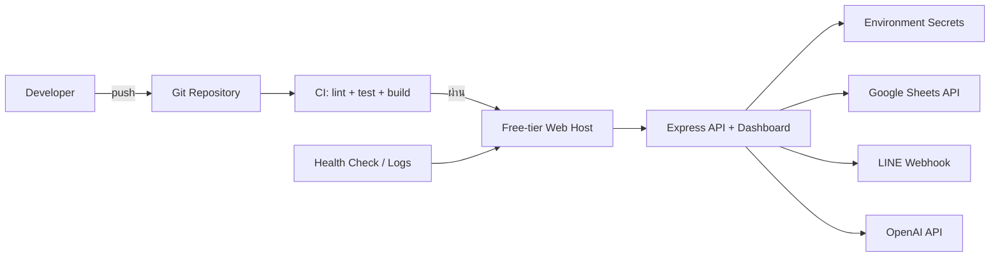

ข้อควรทราบ: hosting อาจฟรี แต่ OpenAI API, LINE message quota และบริการภายนอกอาจมีค่าใช้จ่ายตามการใช้งาน จึงต้องกำหนด budget, rate limit และ usage alert ก่อนเปิด production

## 16. เส้นเรื่องสำหรับการนำเสนอ 5 นาที

1. **ปัญหา:** เกษตรกรสูงอายุบันทึกเอกสารยาก และข้อมูลที่ไม่ครบอาจกระทบสิทธิ์มาตรฐาน
2. **จุดเริ่ม:** เกษตรกรพูดผ่าน LINE ที่ใช้อยู่แล้ว
3. **การแปลงข้อมูล:** ระบบถอดเสียง สกัดข้อมูล และตรวจด้วยกฎที่อธิบายได้
4. **ความน่าเชื่อถือ:** AI ไม่ได้ตัดสินลำพัง รายการเสี่ยงเข้าสู่ human review พร้อมหลักฐานและ audit trail
5. **ผลลัพธ์:** กิจกรรมที่ยืนยันแล้วเชื่อมสู่ล็อตและ QR ตรวจสอบย้อนหลัง
6. **ความพร้อมใช้งาน:** ระบบรับมือ webhook ซ้ำ บริการล่ม และการย้ายฐานข้อมูล โดยไม่ทำข้อมูลสูญหาย

## 17. ข้อสรุปที่ต้องยืนยันก่อน production

- รายการสารอนุญาต สารห้ามใช้ และผู้มีอำนาจอนุมัติกฎ
- เกณฑ์ confidence และกิจกรรมใดต้อง human review เสมอ
- ระยะเวลาเก็บไฟล์เสียงและนโยบายความเป็นส่วนตัว
- ข้อมูลใดเปิดเผยบนหน้า trace สาธารณะได้
- รูปแบบการยืนยันตัวตนเกษตรกรและเจ้าหน้าที่
- ผู้รับผิดชอบเมื่อพบรายการเสี่ยงและ SLA ในการตรวจ

